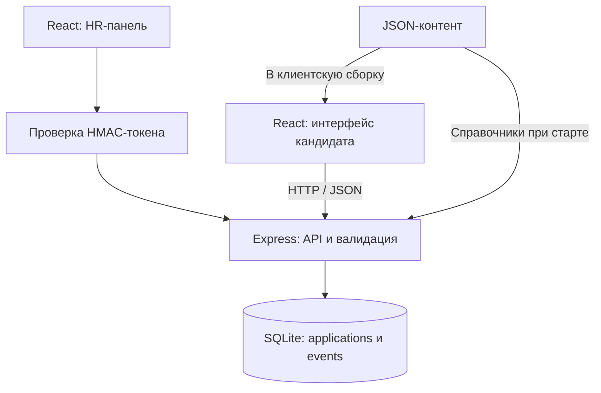
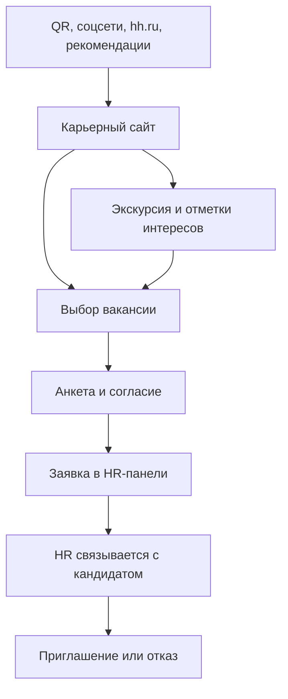

# Проект "Очаково изнутри". Команда - "трагедия белок"

Карьерный веб-сервис с игровой экскурсией по производству для студентов и выпускников. MVP для хакатона «Открой Моспром».

Кандидат знакомится с производством реальных продуктов компании, отмечает интересные профессии и оставляет заявку. HR-специалист просматривает отклики, меняет статусы, выгружает CSV и анализирует действия посетителей. Откликнуться можно и без игры.

## Стек и технологии

| Часть | Технологии |
|---|---|
| Интерфейс | React 18, TypeScript, Vite 5 |
| Backend | Node.js, Express 4, REST API, JSON |
| Хранение | SQLite, better-sqlite3, режим WAL |
| Доступ HR | Пароль и подписанный HMAC-токен на 12 часов |
| Контент | JSON: экскурсии, вакансии, квиз и справочники анкеты |

## Локальный запуск

Нужны **Node.js 22.x**, npm, Git и браузер. Отдельный сервер БД и внешние API не требуются. Все команды выполняются в корне проекта.
Если Node.js не установлен на локальной машине(на вашем компьютере, где будет проводится тестирование работы сервиса) - 
Установка Node.js 22 и npm на Windows — выполните в PowerShell:
```bash
winget install --id OpenJS.NodeJS.22 -e
```
После установки закройте и заново откройте терминал, затем проверьте:
```bash
node --version
npm --version
```
Если winget недоступен, установите Node.js 22 через установщик с официального сайта.

**1. Скачать проект и установить зависимости:**

```bash
git clone https://github.com/kowrzya/ochakovo-game-v2.git
cd ochakovo-game-v2
npm ci
```

**2. Скопировать `.env.example` в `.env`:**

- Linux/macOS: `cp .env.example .env`.
- Windows PowerShell: `Copy-Item .env.example .env`. В `cmd copy .env.example .env`

В `.env` задайте свои `ADMIN_PASSWORD` — пароль HR и `SESSION_SECRET` — длинную случайную строку для подписи токенов. Без этих переменных пароль будет `ochakovo-demo`, а секрет сгенерируется при старте, сбрасывая старые токены после рестарта.

Порт API по умолчанию — `3001` (`PORT`), файл БД — `data/app.db` (`DB_PATH`). Для первого запуска оставьте их без изменений. При смене `PORT` обновите прокси в `vite.config.ts`. После изменения `.env` перезапустите сервер.

**3. Запустить:**

```bash
npm run seed  # **необязательно**: добавить демо-данные для HR
npm run dev   # одновременно запустить API и интерфейс
```

Пройдите по ссылке на localhost, указанной в терминале
База и таблицы создаются автоматически. Терминал оставьте открытым, остановка — `Ctrl+C`. Для следующих запусков достаточно `npm run dev`: повторный `seed` добавит ещё один набор демо-записей.


## Адреса

| Что открыть | Разработка | 
|---|---|
| Главная, игра, вакансии | http://localhost:5174/ | 
| HR-панель | http://localhost:5174/admin |
| Проверка API | http://localhost:3001/api/health | 

В `/api/health` должно быть `"ok": true`. Если `5174` занят, используйте адрес Vite из терминала. Пример ссылки с источником: `http://localhost:5174/?from=hh`. Метки: `hh`, `friend`, `excursion`, `fair`, `ads`; `vk` и `tg` учитываются как `ads`.

## Структура

| Путь | Назначение |
|---|---|
| `client/src/game/` | Главная, экскурсия, вакансии, пробы профессий, анкета |
| `client/src/admin/` | Вход HR, заявки, статусы, статистика |
| `client/src/data/` | Контент: `home.json`, `tour.json`, `scenes.json`, `directions.json` |
| `client/src/api.ts`, `client/src/source.ts` | Запросы, события, сессия и источники переходов |
| `client/public/` | Логотип, изображения, пиктограммы и видео |
| `server/` | API, проверка анкеты, SQLite, загрузка окружения, seed и очистка |
| `data/app.db`, `dist/` | База и собранный клиент, создаются локально |

## Проблема и наше решение

ОЧАКОВО знают по напиткам, но молодым кандидатам сложнее представить работу на производстве. Компании нужен понятный путь от знакомства с работодателем до заявки.

Сервис показывает две экскурсии по шесть этапов и пять направлений: лабораторию, розлив, технологический цех, склад и инженерную службу. Кандидат изучает задачи и условия, пробует профессию и откликается. HR получает структурированные заявки и статистику интереса.

Отмеченные пользователем направления показываются первыми. Это знакомство с профессиями, а не оценка способностей. Влияние на найм требует проверки в пилоте.

## Архитектура приложения

Один backend обслуживает игру и HR-панель. В разработке Vite (`5174`) проксирует `/api` на Express (`3001`). После сборки Express раздаёт API и интерфейс из `dist/`.



`applications` хранит анкеты и статусы, `events` — действия посетителей. Записи логически связаны через `session_id`; все обращения к БД выполняет сервер.

## API

| Метод | Путь | Назначение |
|---|---|---|
| GET | `/api/health` | Состояние сервера и число заявок |
| POST | `/api/events` | Событие: `sessionId`, `type`, необязательные `scene`, `direction`, `source` |
| POST | `/api/applications` | Проверить и сохранить анкету, вернуть `{ "id": ... }` |
| POST | `/api/admin/login` | Вход: `{ "password": "..." }`, ответ `{ "token": "..." }` |
| GET | `/api/admin/stats` | Воронка, просмотры направлений и источники |
| GET | `/api/admin/applications` | До 1000 последних заявок и справочники подписей |
| PATCH | `/api/admin/applications/:id` | Смена статуса: `{ "status": "contacted" }` |
| GET | `/api/admin/export.csv` | Выгрузка заявок в CSV для Excel |

HR-методы, кроме входа, требуют `Authorization: Bearer <token>`. Экспорт также принимает `?token=...`. Для статистики, списка и CSV параметр `demo=0` исключает демо-записи.

Типы событий: `open`, `start`, `scene`, `finish`, `apply`. Статусы: `new`, `contacted`, `invited`, `rejected`. Анкета содержит контакты, дату рождения, образование, опыт, вакансию, готовность, источник и согласие. Сервер проверяет возраст 18–70 лет. Ошибки анкеты — `422`, неверный вход/токен — `401`, превышение 10 отправок за 10 минут с IP — `429`.

## Бизнес-схема



Сайт фиксирует действия для аналитики, HR вручную обрабатывает отклики. Визиты по каналам считаются по `?from=`, заявки — по ответу в анкете. KPI «экскурсия → заявка» включает прямые отклики и не является точной конверсией завершивших игру.

## Сценарии пользователей

Тестовые данные : **Тестов Тест**, **+7 900 123-45-67**, дата рождения **2000-01-01**. E-mail необязателен.

### Кандидат

| Действия | Ожидаемый результат |
|---|---|
| Выбрать напиток для игры, пройти шесть этапов, отметить понравившеюся профессию | Экскурсия завершена, отмеченные направления показаны первыми |
| Открыть вакансию, попробовать задачу, по желанию пройти бонусный квиз | Показаны условия, обратная связь по задаче и результат квиза |
| Заполнить анкету и дать согласие | Появляется «Заявка отправлена!», запись доступна HR |
| Сразу открыть нужную вакансию с главной и откликнуться без экскурсии | Прямой отклик работает |
| Убрать согласие, указать неверный телефон или возраст младше 18 лет | Заявка не отправляется, интерфейс сообщает причину |

Для варианта «Сейчас учусь» обязательны вуз/колледж и курс; для «Уже не учусь» — уровень образования. Также заполните опыт, готовность к выходу и источник.

### HR

| Действия | Ожидаемый результат |
|---|---|
| Открыть `/admin`, проверить неверный пароль, затем войти с `ADMIN_PASSWORD` | При ошибке отказ, при верном пароле доступ к панели |
| Скрыть демо, нажать «Обновить», найти «Тестов Тест» | Видна новая заявка; поиск работает по ФИО, телефону и учебному заведению |
| Сменить статус на «Связались» и обновить страницу | Статус сохраняется |
| Скачать CSV | Файл содержит заявку и корректную кириллицу; поиск в таблице не ограничивает экспорт |
| Показать демо-данные и проверить статистику | Видны демо-записи, этапы экскурсии и просмотры направлений |

Автотесты в npm-скриптах не предусмотрены. `npm run build` проверяет TypeScript и сборку; сценарии выше выполняются вручную.
